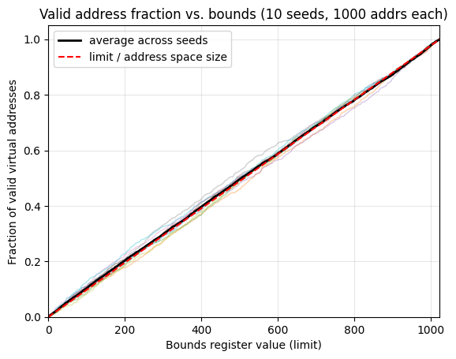

# Chapter 15

1.

```bash
ubuntu@cs5600:~/ostep-homework/vm-mechanism$ ./relocation.py -s 1 -c
ARG seed 1
ARG address space size 1k
ARG phys mem size 16k

Base-and-Bounds register information:

  Base   : 0x0000363c (decimal 13884)
  Limit  : 290

Virtual Address Trace
  VA  0: 0x0000030e (decimal:  782) --> SEGMENTATION VIOLATION
  VA  1: 0x00000105 (decimal:  261) --> VALID: 0x00003741 (decimal: 14145)
  VA  2: 0x000001fb (decimal:  507) --> SEGMENTATION VIOLATION
  VA  3: 0x000001cc (decimal:  460) --> SEGMENTATION VIOLATION
  VA  4: 0x0000029b (decimal:  667) --> SEGMENTATION VIOLATION
```

For one only VA 1 is valid, to calculate the translation that occurs we will have to do VA - Base to get the true hardware address. In decimal this is 14145 - 13884 = 261

```bash
ubuntu@cs5600:~/ostep-homework/vm-mechanism$ ./relocation.py -s 2 -c
ARG seed 2
ARG address space size 1k
ARG phys mem size 16k

Base-and-Bounds register information:

  Base   : 0x00003ca9 (decimal 15529)
  Limit  : 500

Virtual Address Trace
  VA  0: 0x00000039 (decimal:   57) --> VALID: 0x00003ce2 (decimal: 15586)
  VA  1: 0x00000056 (decimal:   86) --> VALID: 0x00003cff (decimal: 15615)
  VA  2: 0x00000357 (decimal:  855) --> SEGMENTATION VIOLATION
  VA  3: 0x000002f1 (decimal:  753) --> SEGMENTATION VIOLATION
  VA  4: 0x000002ad (decimal:  685) --> SEGMENTATION VIOLATION
```

0 -> 15586 - 15529 = 57
1 -> 15615 - 15529 = 86

```bash
ubuntu@cs5600:~/ostep-homework/vm-mechanism$ ./relocation.py -s 3 -c

ARG seed 3
ARG address space size 1k
ARG phys mem size 16k

Base-and-Bounds register information:

  Base   : 0x000022d4 (decimal 8916)
  Limit  : 316

Virtual Address Trace
  VA  0: 0x0000017a (decimal:  378) --> SEGMENTATION VIOLATION
  VA  1: 0x0000026a (decimal:  618) --> SEGMENTATION VIOLATION
  VA  2: 0x00000280 (decimal:  640) --> SEGMENTATION VIOLATION
  VA  3: 0x00000043 (decimal:   67) --> VALID: 0x00002317 (decimal: 8983)
  VA  4: 0x0000000d (decimal:   13) --> VALID: 0x000022e1 (decimal: 8929)
```

3 -> 8983 - 8916 = 67
4 -> 8929 - 8916 = 13

2.

```bash
ubuntu@cs5600:~/ostep-homework/vm-mechanism$ ./relocation.py -s 0 -n 10 -c -l 930

ARG seed 0
ARG address space size 1k
ARG phys mem size 16k

Base-and-Bounds register information:

  Base   : 0x0000360b (decimal 13835)
  Limit  : 930

Virtual Address Trace
  VA  0: 0x00000308 (decimal:  776) --> VALID: 0x00003913 (decimal: 14611)
  VA  1: 0x000001ae (decimal:  430) --> VALID: 0x000037b9 (decimal: 14265)
  VA  2: 0x00000109 (decimal:  265) --> VALID: 0x00003714 (decimal: 14100)
  VA  3: 0x0000020b (decimal:  523) --> VALID: 0x00003816 (decimal: 14358)
  VA  4: 0x0000019e (decimal:  414) --> VALID: 0x000037a9 (decimal: 14249)
  VA  5: 0x00000322 (decimal:  802) --> VALID: 0x0000392d (decimal: 14637)
  VA  6: 0x00000136 (decimal:  310) --> VALID: 0x00003741 (decimal: 14145)
  VA  7: 0x000001e8 (decimal:  488) --> VALID: 0x000037f3 (decimal: 14323)
  VA  8: 0x00000255 (decimal:  597) --> VALID: 0x00003860 (decimal: 14432)
  VA  9: 0x000003a1 (decimal:  929) --> VALID: 0x000039ac (decimal: 14764)
```

I noticed when running it a lot that bigger numbers for the bounds produced better results. When searching for the smallest number that would have all addresses valid I found you have to set the bounds register to the largest address generated + 1. So the base doesn't actually matter here, as long as the addresses generated are within the bounds we set there is no segmentation violation.

3. I saw that when I run with a very large number I get an error that says:

```bash
Error: address space does not fit into physical memory with those base/bounds values.
Base + Limit: 10000000   Psize: 16384
```

With that I found that 16284 (have to factor in the + 100 for the limit) will fit in memory. 16285 will not as it is over the base + limit Psize. This checks out because 16k is 16384 bytes.

4. I tried many different values for -a and -p and the rules held. The bound check is still virtual address < the limit & base + limit needs to be less than the physical memory size. The translation stays the same even as the size scaled up.

5. I used `matplotlib` to create the following chart. 

```python
import random
import bisect
import matplotlib.pyplot as plt

ASIZE = 1024
NUM_ADDRS = 1000
SEEDS = range(10)

limits = list(range(0, ASIZE + 1))
all_fracs = []

for seed in SEEDS:
    random.seed(seed)
    vas = sorted(int(ASIZE * random.random()) for _ in range(NUM_ADDRS))
    fracs = [bisect.bisect_left(vas, lim) / NUM_ADDRS for lim in limits]
    all_fracs.append(fracs)
    plt.plot(limits, fracs, alpha=0.35, linewidth=1)

avg = [sum(col) / len(col) for col in zip(*all_fracs)]
plt.plot(limits, avg, color="black", linewidth=2, label="average across seeds")
plt.plot(limits, [l / ASIZE for l in limits], "r--", label="limit / address space size")

plt.xlabel("Bounds register value (limit)")
plt.ylabel("Fraction of valid virtual addresses")
plt.title(f"Valid address fraction vs. bounds ({len(SEEDS)} seeds, {NUM_ADDRS} addrs each)")
plt.xlim(0, ASIZE)
plt.ylim(0, 1.05)
plt.grid(True, alpha=0.3)
plt.legend()
plt.show()
```



# Chapter 16
