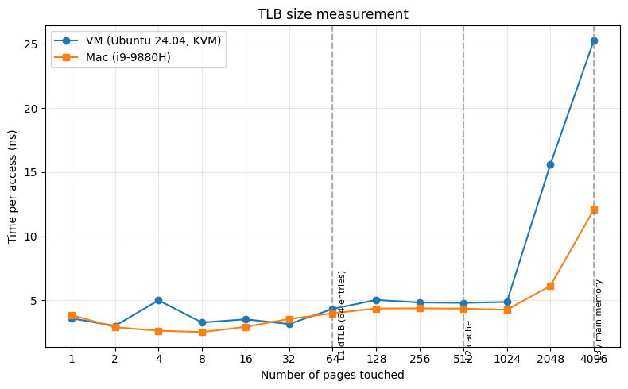

1.

I ran the following commands as instructed:

```
./paging-linear-translate.py -P 1k -a 1m -p 512m -v -n 0
  ...
  [    1023]  0x00000000

./paging-linear-translate.py -P 1k -a 2m -p 512m -v -n 0
  [    2047]  0x00000000

./paging-linear-translate.py -P 1k -a 4m -p 512m -v -n 0
  [    4095]  0x8002e298
```

It scales linearly with the address space size. I expected 2x between 1m to 2m then 2m to 4m, but it was 2n - 1. 1023*2 - 1 = 2047, 2047*2 - 1 = 4095. Not totally sure why (the -1?).

2. The page table should shrink as page size grows. Number of entries = address_space / page_size, so a bigger page means fewer entries.

```
./paging-linear-translate.py -P 1k -a 1m -p 512m -v -n 0
  [    1023]  0x00000000

./paging-linear-translate.py -P 2k -a 1m -p 512m -v -n 0
  [     511]  0x00000000

./paging-linear-translate.py -P 4k -a 1m -p 512m -v -n 0
  [     255]  0x8001fb27
```

We dont use huge pages in general because they waste space (internal fragmentation).

3.

```
ubuntu@cs5600:~/ostep-homework/vm-paging$ ./paging-linear-translate.py -P 1k -a 16k -p 32k -v -u 0
ARG seed 0
ARG address space size 16k
ARG phys mem size 32k
ARG page size 1k
ARG verbose True
ARG addresses -1


The format of the page table is simple:
The high-order (left-most) bit is the VALID bit.
  If the bit is 1, the rest of the entry is the PFN.
  If the bit is 0, the page is not valid.
Use verbose mode (-v) if you want to print the VPN # by
each entry of the page table.

Page Table (from entry 0 down to the max size)
  [       0]  0x00000000
  [       1]  0x00000000
  [       2]  0x00000000
  [       3]  0x00000000
  [       4]  0x00000000
  [       5]  0x00000000
  [       6]  0x00000000
  [       7]  0x00000000
  [       8]  0x00000000
  [       9]  0x00000000
  [      10]  0x00000000
  [      11]  0x00000000
  [      12]  0x00000000
  [      13]  0x00000000
  [      14]  0x00000000
  [      15]  0x00000000

Virtual Address Trace
  VA 0x00003a39 (decimal:    14905) --> PA or invalid address?
  VA 0x00003ee5 (decimal:    16101) --> PA or invalid address?
  VA 0x000033da (decimal:    13274) --> PA or invalid address?
  VA 0x000039bd (decimal:    14781) --> PA or invalid address?
  VA 0x000013d9 (decimal:     5081) --> PA or invalid address?

For each virtual address, write down the physical address it translates to
OR write down that it is an out-of-bounds address (e.g., segfault).
```

For VA 0x3a39, the address space is 16k so the VA is 14 bits (16k = 2^14). Page size 1k = 2^10, so offset is 10 bits and VPN is 4 bits. Every page table entry is 0x0, so nothing is valid. All five VAs are invalid/segfault because -u 0 allocated 0% of pages.

With -u 25:

```
ubuntu@cs5600:~/ostep-homework/vm-paging$ ./paging-linear-translate.py -P 1k -a 16k -p 32k -v -u 25
ARG seed 0
ARG address space size 16k
ARG phys mem size 32k
ARG page size 1k
ARG verbose True
ARG addresses -1


The format of the page table is simple:
The high-order (left-most) bit is the VALID bit.
  If the bit is 1, the rest of the entry is the PFN.
  If the bit is 0, the page is not valid.
Use verbose mode (-v) if you want to print the VPN # by
each entry of the page table.

Page Table (from entry 0 down to the max size)
  [       0]  0x80000018
  [       1]  0x00000000
  [       2]  0x00000000
  [       3]  0x00000000
  [       4]  0x00000000
  [       5]  0x80000009
  [       6]  0x00000000
  [       7]  0x00000000
  [       8]  0x80000010
  [       9]  0x00000000
  [      10]  0x80000013
  [      11]  0x00000000
  [      12]  0x8000001f
  [      13]  0x8000001c
  [      14]  0x00000000
  [      15]  0x00000000

Virtual Address Trace
  VA 0x00003986 (decimal:    14726) --> PA or invalid address?
  VA 0x00002bc6 (decimal:    11206) --> PA or invalid address?
  VA 0x00001e37 (decimal:     7735) --> PA or invalid address?
  VA 0x00000671 (decimal:     1649) --> PA or invalid address?
  VA 0x00001bc9 (decimal:     7113) --> PA or invalid address?

For each virtual address, write down the physical address it translates to
OR write down that it is an out-of-bounds address (e.g., segfault).
```

For 0x3986: binary is 11100110000110. First 4 bits 1110 = 14, entry 14 is 0x0, invalid. For 0x2bc6: binary 10101111000110. First 4 bits 1010 = 10, entry 10 is 0x80000013, valid, PFN = 0x13 = 19. offset = last 10 bits = 1111000110 = 966. PA = 19 * 1024 + 966 = 20422 = 0x4fc6.

With -u 50:

```
ubuntu@cs5600:~/ostep-homework/vm-paging$ ./paging-linear-translate.py -P 1k -a 16k -p 32k -v -u 50
ARG seed 0
ARG address space size 16k
ARG phys mem size 32k
ARG page size 1k
ARG verbose True
ARG addresses -1


The format of the page table is simple:
The high-order (left-most) bit is the VALID bit.
  If the bit is 1, the rest of the entry is the PFN.
  If the bit is 0, the page is not valid.
Use verbose mode (-v) if you want to print the VPN # by
each entry of the page table.

Page Table (from entry 0 down to the max size)
  [       0]  0x80000018
  [       1]  0x00000000
  [       2]  0x00000000
  [       3]  0x8000000c
  [       4]  0x80000009
  [       5]  0x00000000
  [       6]  0x8000001d
  [       7]  0x80000013
  [       8]  0x00000000
  [       9]  0x8000001f
  [      10]  0x8000001c
  [      11]  0x00000000
  [      12]  0x8000000f
  [      13]  0x00000000
  [      14]  0x00000000
  [      15]  0x80000008

Virtual Address Trace
  VA 0x00003385 (decimal:    13189) --> PA or invalid address?
  VA 0x0000231d (decimal:     8989) --> PA or invalid address?
  VA 0x000000e6 (decimal:      230) --> PA or invalid address?
  VA 0x00002e0f (decimal:    11791) --> PA or invalid address?
  VA 0x00001986 (decimal:     6534) --> PA or invalid address?

For each virtual address, write down the physical address it translates to
OR write down that it is an out-of-bounds address (e.g., segfault).
```

With -u 100:

```
ubuntu@cs5600:~/ostep-homework/vm-paging$ ./paging-linear-translate.py -P 1k -a 16k -p 32k -v -u 100
ARG seed 0
ARG address space size 16k
ARG phys mem size 32k
ARG page size 1k
ARG verbose True
ARG addresses -1


The format of the page table is simple:
The high-order (left-most) bit is the VALID bit.
  If the bit is 1, the rest of the entry is the PFN.
  If the bit is 0, the page is not valid.
Use verbose mode (-v) if you want to print the VPN # by
each entry of the page table.

Page Table (from entry 0 down to the max size)
  [       0]  0x80000018
  [       1]  0x80000008
  [       2]  0x8000000c
  [       3]  0x80000009
  [       4]  0x80000012
  [       5]  0x80000010
  [       6]  0x8000001f
  [       7]  0x8000001c
  [       8]  0x80000017
  [       9]  0x80000015
  [      10]  0x80000003
  [      11]  0x80000013
  [      12]  0x8000001e
  [      13]  0x8000001b
  [      14]  0x80000019
  [      15]  0x80000000

Virtual Address Trace
  VA 0x00002e0f (decimal:    11791) --> PA or invalid address?
  VA 0x00001986 (decimal:     6534) --> PA or invalid address?
  VA 0x000034ca (decimal:    13514) --> PA or invalid address?
  VA 0x00002ac3 (decimal:    10947) --> PA or invalid address?
  VA 0x00000012 (decimal:       18) --> PA or invalid address?

For each virtual address, write down the physical address it translates to
OR write down that it is an out-of-bounds address (e.g., segfault).
```

All entries are valid now. So as -u goes up, more pages get allocated and more VAs translate instead of segfaulting.

4. All three are unrealistic in different ways.

```
-P 8 -a 32 -p 1024: page 8 bytes, address space 32 bytes. too small to matter.
-P 8k -a 32k -p 1m: page fine but address space is only 4 pages.
-P 1m -a 256m -p 512m: page size 1m is way too big, huge internal fragmentation.
```

5. Limits I hit (from my paging-experiments.sh):

```
-P 1k -a 32m -p 16m: Error physical memory size must be GREATER than address space size
-P 1k -a 16m -p 16m: same error (equal is not allowed)
-P 1000m -a 1m -p 512m: address space must be a multiple of the pagesize
-P 1k -a 12k -p 512m: address space must be a power of 2
-P 2k -a 4k -p 5k: physical memory must be a multiple of the pagesize
-P 1k -a 1g -p 2g: must use smaller sizes (less than 1 GB)
-P 0: crashes with ZeroDivisionError
```

So it needs phys mem strictly bigger than address space, both multiples of page size, address space and page size powers of 2, and everything under 1GB.

# Chapter 19

1. gettimeofday returns microseconds, so 1us resolution. A page access is approx 3ns, way smaller than that. So you loop a lot. 100000 trials on 1 page is approx 300us, about 300x the resolution. enough to time it.

2. For this question I wrote tlb.c. It takes pages and trials as args, mallocs pages*4096 bytes, touches one int per page (jump = 4096/4 = 1024), times a loop that walks all pages trials times, and prints ns per access.

3. I wrote run-tlb.sh for this question. It compiles tlb.c and loops pages 1..4096 doubling, 100000 trials each. Ran on my VM (Ubuntu 24.04, 4 cpus) and my mac (i9-9880H). 
```
# ubuntu-vm
1 100000 3.60
2 100000 3.00
4 100000 5.00
8 100000 3.27
16 100000 3.52
32 100000 3.15
64 100000 4.33
128 100000 5.03
256 100000 4.83
512 100000 4.80
1024 100000 4.87
2048 100000 15.61
4096 100000 25.29

# mac
1 100000 3.86
2 100000 2.90
4 100000 2.63
8 100000 2.52
16 100000 2.93
32 100000 3.55
64 100000 3.99
128 100000 4.36
256 100000 4.37
512 100000 4.35
1024 100000 4.26
2048 100000 6.13
4096 100000 12.09
```

100000 trials is enough. Total work is in the ms range, far above the 1us resolution.

4. I wrote plot.py. It uses matplotlib to plot pages vs ns/access. The graph is flat where pages fit in the TLB, bumps up around 64-128 pages (L1 dTLB has 64 entries * 4k = 256k), then jumps at the end into main memory. A graph shows the this instantly, raw numbers dont.



5. The compiler can delete the loop if it thinks the result is never used. Fix: mark the array volatile, or use the result. I sum into a variable and return it, so the loop has to run. I also compile with -O0.

6. Pin to one cpu or the scheduler moves the process and each core has its own cold TLB, giving slow misses and noisy numbers. Linux: taskset -c 0 or sched_setaffinity. mac: thread_affinity_policy. My tlb.c pins itself to cpu 0 on both.

7. First access to a page is slow (demand zeroing and a page fault). If that is inside the timed loop it messes up the average. I fixed this by doing a  pre-touch each page before timing. Options were pre-touch, a warmup trial you throw away, or mmap with MAP_POPULATE. Pre-touch seemed like the simplest. The cost is extra init time, but it is outside the timer so it doesnt hurt.
